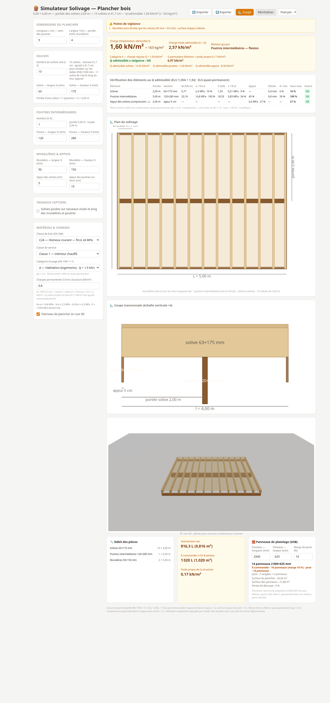
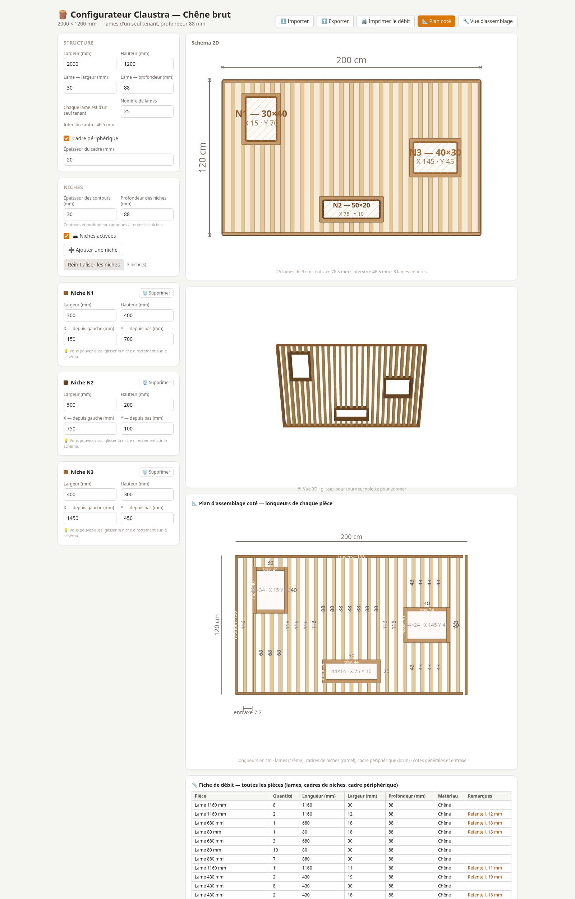

> ## ⚠️ Avertissement — contenu généré par IA
> Ce projet est **entièrement généré par une IA** (« AI slop ») : code, textes et
> captures d'écran, sans revue experte systématique. **Ne l'utilisez pas tel quel pour
> un ouvrage réel.** Les calculs (charges admissibles, sections, débits) sont des
> estimations indicatives simplifiées (voir les avertissements intégrés à chaque
> application) et **ne remplacent pas une note de calcul réalisée par un bureau
> d'études / ingénieur structure**, ni le respect des normes en vigueur (Eurocodes,
> DTU) et des règles de l'art. En cas de doute, faites vérifier par un professionnel
> avant toute fabrication ou mise en œuvre.

# Générateurs bois — web

Deux applications 100 % statiques pour la conception de petits ouvrages en bois.
Chaque application est un **fichier HTML autonome** (React 18 + Three.js via CDN, aucune étape de build) :
il suffit de l'ouvrir dans un navigateur.

| Application | Fichier |
|---|---|
| 🪵 Simulateur de solivage (plancher bois) | [`floor_framing/solivage-app.html`](floor_framing/solivage-app.html) |
| 📐 Configurateur de claustra | [`claustra/claustra-app.html`](claustra/claustra-app.html) |

## Utilisation

```bash
# soit ouvrir directement le fichier HTML dans un navigateur,
# soit servir le dépôt :
python3 -m http.server 8000
# puis http://localhost:8000/floor_framing/solivage-app.html
#  et http://localhost:8000/claustra/claustra-app.html
```

Les configurations sont sauvegardées automatiquement dans le navigateur (`localStorage`)
et peuvent être **exportées / importées** en JSON.

---

## 🪵 Simulateur de solivage — plancher bois



Simulateur de plancher à solives avec **calcul en temps réel de la charge admissible**
(approche simplifiée EN 1995 : ELU 1,35 G + 1,5 Q, ELS quasi-permanent pour la flèche).

- **Dimensions du plancher** : longueur, largeur (portée des solives entre muralières).
- **Solives** : saisies par **nombre** ; l'entraxe est ajusté automatiquement pour tomber
  sur un multiple de la longueur des dalles OSB (2500 mm par défaut) ; solives de rive
  posées pleine largeur sur les appuis, une solive de rive supplémentaire au mur opposé.
- **Poutres intermédiaires** (nombre configurable) et **muralières** : sections saisies par l'utilisateur.
- **Tasseaux (option)** : solives posées sur tasseaux vissés le long des muralières/poutres
  pour gagner de la hauteur sous plafond ; si `hauteur tasseau + hauteur solive` dépasse la
  hauteur des appuis, les solives sont entaillées en bout pour affleurer (hauts coplanaires).
- **Charge admissible** : calculée en direct (solives, poutres, appuis en compression ⊥),
  élément goulant et taux d'utilisation affichés, verdict OK / INSUFFISANT.
- **Catégorie d'usage** (A à E, EN 1991-1-1) : pilote la charge d'exploitation requise,
  le ψ2 et la flèche limite.
- **Platelage OSB** : dalles standard rainure/languette 2500 × 625 mm (modifiables),
  nombre de panneaux, surface et **marge de perte de découpe** → quantité à commander.
- Vues : **plan**, **coupe transversale**, **3D** (Three.js), tableau de vérification par élément.
- **i18n français / anglais** (sélecteur de langue, formats de nombres localisés).

---

## 📐 Configurateur de claustra



Configurateur de claustra en lames de bois avec niches, vues 2D/3D et **fiche de débit imprimable**.

- **Structure** : largeur/hauteur en mm, section des lames, nombre de lames (entraxe auto),
  cadre périphérique optionnel (épaisseur réglable).
- **Niches** : ajout/suppression générique (boutons), déplacement par glisser-déposer sur le schéma,
  **épaisseur des contours** et **profondeur communes** à toutes les niches (carte dédiée),
  activation/désactivation globale par case à cocher.
- Vues : **schéma 2D interactif**, **plan d'assemblage coté** (longueur de chaque pièce),
  **vue 3D** (Three.js), **vue d'assemblage des pièces** annotée.
- **Fiche de débit unifiée** en mm (pièce, quantité, longueur, largeur, profondeur, matériau,
  remarques) + volumes de bois (net et avec pertes).
- **Impression** : bouton dédié produisant une page imprimable (configuration, vues cotées,
  débit) — `Ctrl+P` fonctionne aussi.
- **Export JSON** via la boîte de dialogue native « Enregistrer sous… » (avec repli
  téléchargement + copie dans le presse-papiers), et **import** de configuration.

---

## Dépôt

```
├── claustra/claustra-app.html      # configurateur de claustra
├── floor_framing/solivage-app.html # simulateur de solivage
└── screenshots/                    # captures d'écran du README
```
